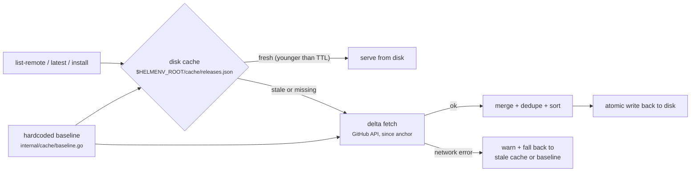

# Caching strategy in `helm-env`

`helm-env` uses a three-layer caching strategy to manage the list of available `helm` versions. With this cache, commands such as `list-remote` and `latest` stay fast and reliable, and they stay within the GitHub API rate limits.



## 1. The three layers

!!! info "Layer 1: Hardcoded baseline"
    The `helm-env` binary contains a hardcoded list of past stable and pre-release versions (see `internal/cache/baseline.go`).

*   The baseline gives a useful starting point with zero latency, even on the very first run.
*   It is the last fallback if both the disk cache and the network are unavailable.
*   The first delta fetch uses the newest version in this list as its "anchor".

!!! info "Layer 2: Disk cache"
    If `HELMENV_ROOT` is set, `helm-env` saves the merged list of versions to a JSON file at `$HELMENV_ROOT/cache/releases.json`.

*   If the cache file is younger than the TTL (time to live), `helm-env` serves it immediately and makes no network calls.
*   Writes use a "write-to-temp then rename" pattern. As a result, concurrent processes never read a partially written file.

!!! info "Layer 3: Delta fetch"
    If the disk cache is stale (older than the TTL) or missing, `helm-env` does a "delta fetch" from the GitHub API.

*   The delta fetch does not get the full history. It requests only the releases that are newer than the most recent version in the stale cache (or the baseline).
*   `helm-env` automatically merges the new releases with the known versions, removes duplicates and sorts the result.
*   If the network is unavailable during a delta fetch, `helm-env` prints a warning. Then it falls back to the stale cache or the hardcoded baseline.

## 2. Configuration

Two environment variables control the cache:

| Variable | Description | Default |
|----------|-------------|---------|
| `HELMENV_ROOT` | Root directory for `helm-env`. If it is not set, the cache is in memory only and `helm-env` does not save it to disk. | N/A |
| `HELMENV_CACHE_TTL` | How long a cache entry stays fresh. Accepts Go duration strings (for example, `1h`, `30m`, `24h`, `0s`). | `1h` |

### Disabling the cache
To force a fresh fetch every time, set the TTL to zero:
```bash
export HELMENV_CACHE_TTL=0s
```

## 3. Storage format

The cache file (`releases.json`) stores these fields:
*   `fetched_at`: UTC timestamp of the last successful fetch.
*   `versions`: List of stable versions (newest-first).
*   `prerelease_versions`: List of all versions including pre-releases (newest-first).

## 4. Maintenance

Maintainers should update the hardcoded baseline periodically, for example when they release a new version of `helm-env`. This keeps the "lower bound" reasonably close to the current state of the world. But even if the baseline is significantly out of date, delta fetches correct the version list automatically.
