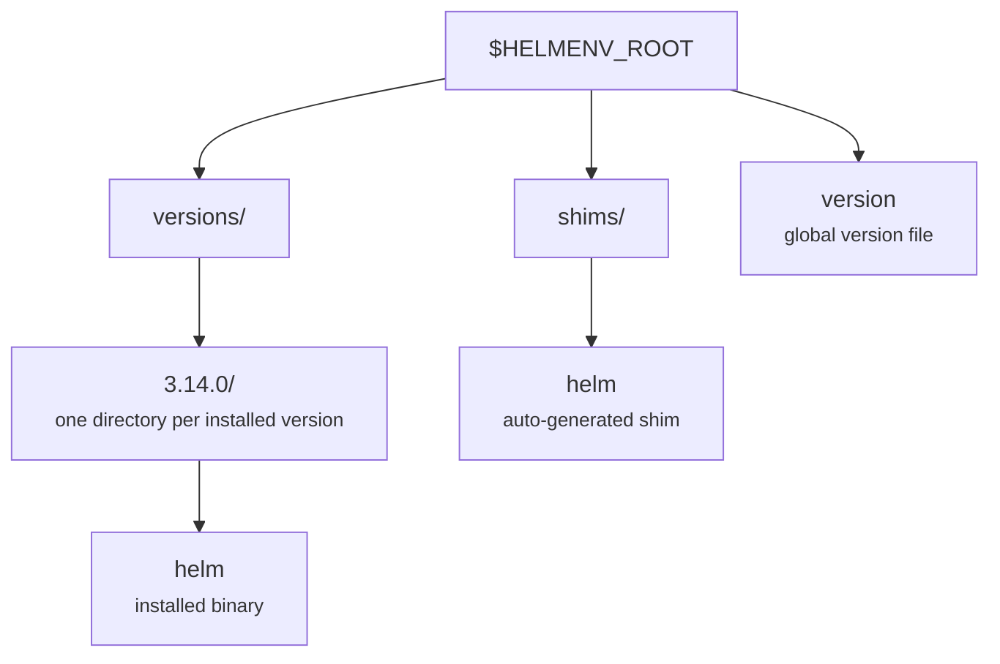

# helm-env documentation

`helm-env` is a version manager for the [`helm`](https://helm.sh) CLI.

It installs multiple `helm` versions under a single root directory and generates a `helm` shim. At runtime, it selects the correct `helm` binary for the version that you configured.

!!! tip "Where to go next"
    - If you are new to `helm-env`, start with [Installation and configuration](installation-and-configuration.md).
    - To look up a flag or command, see the [CLI reference](cli-reference.md).
    - To learn how `list-remote` and `latest` stay fast and work offline, read about the [caching strategy](caching.md).

## Guides

- [Installation and configuration](installation-and-configuration.md)
- [CLI reference](cli-reference.md)
- [Caching strategy](caching.md)

## How version selection works

When you run `helm ...`, the shim selects a version in this order of priority:

1. Shell version: `HELMENV_VERSION`. Typically, `helm-env shell` sets it after `eval "$(helm-env init)"`.
2. Local version: a `.helm-version` file in the current directory or any parent directory.
3. Global version: `$HELMENV_ROOT/version`.

If you do not configure a version, the shim fails with an actionable error message.

## Project layout under `HELMENV_ROOT`

By default, `HELMENV_ROOT` is `~/.helmenv`.

